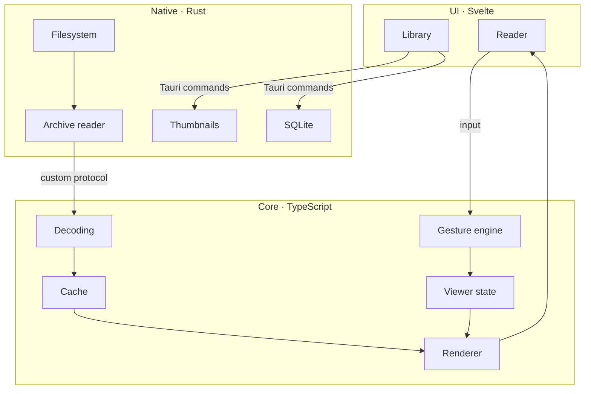

# gutter — Design document

Started Oct 28, 2026 · Samuele

## Overview and goals

An open-source comic book reader for desktop and mobile that shows pages at full quality and responds to gestures predictably. It exists because the free readers available today degrade images, handle zoom and scroll poorly, and have a dated interface.

Guiding principles:

- **The page comes first.** While reading, only the comic is on screen; controls appear when needed.
- **Never lose quality.** No image is ever shown at a resolution lower than the screen's.
- **Predictable gestures.** One gesture does one thing; no accidental page turns.
- **Lightweight.** Fast startup, low memory, small installer.
- **One codebase** for Windows, Linux, macOS, Android and iOS.

Non-goals for the first version: online store or comic downloads, cloud sync, file editing, DRM support.

## Requirements

The requirements come from five concrete problems with existing readers, plus the basic features of an MVP.

### Problems to solve

| Problem | Requirement | How we verify it |
| --- | --- | --- |
| Pages lose quality | Always render at the screen's physical resolution; sharp re-render after zoom | On-screen comparison with the original image at 100%, 200%, 400% |
| Poor zoom handling | Pinch centered between the fingers, double tap on an area, pan clamped to the edges | Manual tests on trackpad, mouse, Android touch |
| Scroll too fast, skipped pages | Page changes only on an intentional gesture; trackpad inertia ignored after a page change | No double skip in 50 consecutive swipes |
| Unintuitive UI | Interface hidden while reading, clear tap zones, at most 2 taps to any setting | A new user opens and reads a comic without instructions |
| Dated look | Modern design, dark theme by default, 60 fps animations | Frame time profiling while flipping and zooming |

### MVP features

1. Open CBZ, CBR and image folders (JPEG, PNG, WebP, AVIF).
2. Reading modes: single page, double page, vertical scroll (webtoon).
3. Reading direction left→right and right→left (manga).
4. Preloading of nearby pages within a memory limit.
5. Library with thumbnails and saved reading position for each volume.

After the MVP: PDF, CB7, fixed-layout EPUB, ComicInfo.xml metadata, collections and series.

## Tech stack

Choice: Tauri 2 as the native shell, TypeScript for the interface, gestures and viewer logic, Svelte for the UI. Rust for everything that touches files and archives: reading, extracting single pages, thumbnails, database.

Why this split: a 100 MB CBZ must never be copied whole into JavaScript. Rust opens the archive, reads the index and hands the webview only the bytes of the requested page.

| Layer | Technology | Why |
| --- | --- | --- |
| App shell | Tauri 2 | One codebase for 5 platforms; uses the system webview, installer of a few MB instead of Electron's ~150 MB |
| Language | TypeScript | Already known; typing helps on a codebase that will grow |
| UI | Svelte 5 | Compiles to JS with no heavy runtime; simple reactivity for viewer state |
| Frontend build | Vite | Standard for Svelte, fast hot reload |
| CBZ archives | Rust `zip` crate | Direct access to a single entry through the ZIP index, without reading the whole file |
| CBR archives | Rust `unrar` crate (or libarchive via `compress-tools`) | Mature native library; avoids compiling to WASM. Final choice depends on licensing (see open questions) |
| Delivering pages to the UI | Tauri custom protocol (e.g. `page://<volume>/<n>`) | The webview loads the page like a URL; no bytes serialized in IPC messages. Verified in the [`page-protocol` spike](spikes/page-protocol.md): at least as fast as IPC |
| Image decoding | The webview's `createImageBitmap` | Native system decoding, off the main thread |
| PDF (post-MVP) | pdf.js | De facto standard for PDF in the browser |
| Native side | Rust (Tauri commands) | Filesystem, archives, parallel thumbnail generation |
| Persistence | SQLite via Tauri plugin | Library and reading positions |
| Tests | Vitest + Playwright | Unit tests of the logic, end-to-end tests of the viewer |

Rejected alternatives: Electron + Capacitor (two projects, heavy apps), Python (weak mobile support), C core with native UI (too much work before the first result), archives in JavaScript with fflate or WASM (fflate works on the whole file in memory; RAR in WASM is fragile and slow).

Known stack risks, to verify in milestone M0.5 before building the rest:

- Tauri 2 on mobile is less mature than on desktop; file access on Android goes through the Storage Access Framework (`content://` URIs, not normal paths). **Verified in the [`android-files` spike](spikes/android-files.md):** Rust opens the picked URI as a seekable file through `tauri-plugin-fs` and reads single ZIP entries without loading the archive.
- System webviews differ: WebView2 (Windows), WebKitGTK (Linux), WKWebView (macOS/iOS), Android System WebView. Image formats, gesture events and memory limits vary between them.
- On Linux, WebKitGTK is the webview with the most known performance issues.

## Architecture

The app has three layers: UI in Svelte, core in TypeScript, native side in Rust. The core does not depend on the UI, so it can be tested on its own. Filesystem and archive reader live in the Rust layer; decoding, cache, renderer, gestures and viewer state in the TypeScript core.

A page travels this chain: Rust opens the archive and extracts only the requested entry, serves it to the webview through the custom protocol, decoding produces the bitmap, the cache keeps it and the renderer draws it in the reader. In parallel, the gesture engine translates the reader's input into changes to the viewer state, which decides what the renderer must show. The library uses thumbnails and SQLite through Tauri commands.

## Rendering pipeline and image quality

Every page is drawn from the original image, at the screen's physical resolution. Thumbnails exist only in the library.

1. **Compute the target size.** On-screen size in CSS pixels × `devicePixelRatio` × zoom level.
2. **Decode and resize together.** The page bytes become an `ImageBitmap` via `createImageBitmap(blob, { resizeWidth, resizeHeight, resizeQuality: 'high' })`: decoding and downscaling happen in one step, off the main thread. If a webview ignores the resize options (to verify in M0.5, especially WebKit), fall back to multi-step downscaling on a canvas with `imageSmoothingQuality: 'high'`. If the original is smaller than the target, show it without more blurry upscaling than necessary.
3. **Keep the original.** The compressed page bytes stay in cache: on zoom, decode again at the new resolution; never upscale an already-reduced bitmap.
4. **Draw.** On a `<canvas>` or `` with exact dimensions, so the browser does not rescale again.
5. **Re-render after zoom.** During the pinch, use a CSS transform (fast but approximate); once the gesture ends, redraw at the new resolution.

For very large pages (scans over ~8000 px per side), high zoom uses tiled rendering: only the visible portion is decoded and drawn. An 8000 × 6000 page decoded in full takes about 190 MB, more than the entire mobile budget.

Formats: JPEG, PNG and WebP are supported by all webviews. AVIF is not supported everywhere (on Windows it depends on the system AV1 extension): if the webview cannot decode it, the page is decoded in Rust (`image` crate) and served as PNG.

Rule: no image is ever recompressed to JPEG or cached at reduced quality for reading.

## Gesture engine

All input (touch, mouse, trackpad, keyboard) goes through a single module that translates it into viewer actions. A gesture produces exactly one action: it either moves the view or changes the page, never both.

The module is a state machine with four states: **idle**, **pan**, **pinch**, **page change in progress**. During a page change every other input is ignored until the animation ends.

| Input | Page not zoomed | Page zoomed |
| --- | --- | --- |
| Horizontal swipe (touch) | Changes page only past a distance **and** velocity threshold; otherwise the page snaps back | Pan; changes page only if already at the edge and the gesture starts again from there |
| Pinch | Zoom centered on the midpoint between the fingers | Same |
| Double tap / double click | 2× zoom on the tapped area | Back to "fit to screen" |
| Tap on the sides | Previous / next page | No action |
| Tap in the center | Show / hide controls | Same |
| Two-finger trackpad scroll | Accumulates movement; changes page past a threshold, then blocks input until inertia dies out | Pan |
| Mouse wheel | One notch = one page | Vertical pan |
| Ctrl + wheel / trackpad pinch | Zoom centered on the cursor | Same |
| Arrows, space, PgUp/PgDn | Page navigation | Pan, then page at the edge |

Telling trackpad inertia apart from intentional scrolling is the most delicate part: browsers do not report it. We estimate it from the trend of `deltaY` values (steadily decreasing values = inertia) and from a lockout window after each page change. This is an empirical estimate: thresholds must be tuned on real devices, they cannot be worked out on paper.

The gesture engine receives normalized events from a small per-platform adapter, because webviews do not produce them the same way. Example: trackpad pinch arrives as a wheel event with `ctrlKey` on Chromium (WebView2, Android), while on WebKit it may arrive as `gesturestart`/`gesturechange`. The state machine never sees these differences.

To make the engine testable without a device, any event sequence can be recorded to a file and replayed in automated tests: a reported gesture bug becomes a test that must never fail again.

Thresholds and sensitivity are configurable in the settings.

## UI/UX

The app has two screens: **Library** and **Reader**. While reading, the interface is invisible until you call it.

**Reader**

- Screen filled only by the page, black or dark grey background.
- Tap in the center: a top bar (title, settings, close) and a bottom bar (page slider with previews, page number) appear.
- Tap zones on the sides: left and right 25% of the screen, swapped in manga mode.
- Modes: single page, double page (with single cover and detection of pages that are already spreads), continuous vertical scroll.
- Fit: to width, to height, to screen.

**Library**

- Grid of covers with a progress indicator.
- "Continue reading" section at the top.
- Add files or folders by drag and drop (desktop) or system picker (mobile).

**Style guidelines**

- Dark theme by default, optional light theme.
- System typography, rounded corners, no superfluous decorative icons.
- Short animations (150–250 ms) for page transitions and controls appearing, always at 60 fps.
- Settings reachable in at most 2 taps, with an immediate preview of the effect.

## Memory management and performance

Only the pages around the current one are kept decoded in memory; everything else stays compressed in the archive.

- **Preload window:** current page + 2 next + 1 previous (in double page mode, by pairs).
- **Memory budget in bytes, not pages:** each bitmap costs width × height × 4 bytes. The budget is configurable, with a lower default on mobile; if a new page exceeds it, the farthest page is freed with `ImageBitmap.close()`, and if the budget cannot fit the whole preload window, the window shrinks (never the quality of the current page).
- **Two cache levels:** compressed bytes (small, we keep many) and decoded bitmaps (large, only around the current page).
- **Read the archive without extracting it all:** Rust reads only the requested page's entry from the ZIP index.
- **Work off the main thread:** extraction in Rust on separate threads, asynchronous decoding in the webview, so the interface never freezes while flipping pages.
- **Thumbnails:** generated once, saved to disk as WebP, lazy-loaded while scrolling the library.

Measurable targets:

| Metric | Target |
| --- | --- |
| Opening a 100 MB CBZ to the first page | < 500 ms on desktop |
| Page change with a preloaded page | < 16 ms (one frame) |
| Viewer memory with a 200-page volume | < 300 MB on desktop, < 150 MB on mobile |
| Desktop installer size | < 15 MB |

## Build, distribution and CI

Development happens on Windows and Linux; builds for all platforms are produced by GitHub Actions, free for public repos.

| Platform | Where it's built | Distribution |
| --- | --- | --- |
| Windows | Locally or Windows runner | MSI/NSIS installer on GitHub Releases |
| Linux | Locally (WSL works too) or Ubuntu runner | AppImage and .deb on GitHub Releases |
| Android | Locally with the Android SDK, or Ubuntu runner | APK on GitHub Releases, then F-Droid |
| macOS | macOS runner only | DMG on GitHub Releases |
| iOS | macOS runner only | TestFlight; requires an Apple Developer account ($99/year) |

CI pipeline on every push to `main`: lint, type check, unit tests, desktop build. On every version tag: build all platforms and publish the release.

License: MIT.

## Development with coding agents and validation

The code is written by coding agents (Claude Code). The person leading the project does not know Tauri, Svelte or Rust, so they do not validate code by reading it: they validate behavior. Every technical decision in this document is a hypothesis until a test or a measurement confirms it.

**Working rules**

- An `AGENTS.md` at the repo root summarizes this document: architecture, rules (e.g. "no image recompression"), build and test commands, workflow. It is the format read by most coding agents, so anyone who clones or forks can work with the agent they prefer.
- `CLAUDE.md` starts with the line `@AGENTS.md`, which imports that file into Claude Code. Instructions live in one place and cannot diverge; any Claude Code–specific notes go below that line.
- `AGENTS.md` is updated in the same change that alters architecture, commands or rules.
- Single maintainer, no pull requests: work lands directly on `main` in small steps, one per feature. The agent prepares each change; the maintainer commits and pushes it. Each step comes with what changes for the user and how to try it in under 5 minutes. See [roadmap.md](roadmap.md).
- CI runs on every push: lint, type check, tests, build. A red CI is fixed before anything else, and it is a signal that doesn't require understanding the code.
- When a choice in this document turns out wrong, the agent updates the document in the same change and explains why in plain language.

**How to validate without reading code**

| What | Tool | What the validator looks at |
| --- | --- | --- |
| Image quality | Automated test: pixel-by-pixel comparison between the rendered page and the original | Pass/fail in CI; side-by-side screenshots shown with each change |
| Performance | Benchmark command that prints the metrics from the targets table | Numbers against thresholds: green or red |
| Memory | Benchmark that flips through a 200-page volume and measures the peak | A number in MB |
| Gestures | Tests with recorded event sequences + manual testing | Manual test checklist per milestone |
| Formats | Corpus of test files in the repo (small CBZ/CBR, huge pages, AVIF, odd file names, corrupt archives) | All of them open or show a clear error |

**Manual checklist for each milestone:** a list of 5–15 concrete actions ("open `test-manga.cbz`, set right→left, tap the left side: it must go forward"). The validator performs them on the built app and marks pass/fail. A fail becomes an issue with steps to reproduce.

**Test devices:** at least one Windows PC, one real Android phone (the emulator is not enough for gestures), Linux via WSL or a real machine. macOS and iOS only after 0.1, once a Mac or a tester is available.

## Roadmap and open questions

We start with the viewer, because that's where all the problems of existing readers are concentrated. The library comes once the viewer is solid.

1. **M0 — Skeleton.** Repo, Tauri 2 + Svelte + TypeScript, CI with desktop build, README, `AGENTS.md` (with `CLAUDE.md` importing it), test file corpus.
2. **M0.5 — Risk check.** Throwaway prototypes that answer yes/no questions before building the rest:
   - Does Rust read a page from a 100 MB CBZ and does the webview show it in under 500 ms? **Yes** ([`page-protocol`](spikes/page-protocol.md))
   - Does `createImageBitmap` with high-quality resize work on WebView2, WebKitGTK and Android?
   - Does the app run on a real Android phone and open a file chosen with the system picker? **Yes** ([`android-files`](spikes/android-files.md))
   - Which image formats does each webview decode?
   - Does trackpad pinch arrive as a usable event on Windows and Linux?

   Every "no" leads to fixing this document before M1.
3. **M1 — Basic viewer.** Open CBZ, single page, high-quality rendering, keyboard and tap navigation.
4. **M2 — Gesture engine.** Zoom, pan, swipe with thresholds, trackpad inertia handling. Testing on Android.
5. **M3 — Reading modes.** Double page, vertical scroll, manga direction, preloading and memory budget.
6. **M4 — Library.** Cover grid, thumbnails, reading position saved in SQLite.
7. **M5 — Formats and release.** CBR, image folders, first public 0.1 release on GitHub.
8. **After 0.1.** PDF, CB7, ComicInfo.xml, iOS and macOS builds, F-Droid.

**Rough estimates.** Estimates assume development by coding agents, with one person leading, testing and validating about 10 hours a week. The bottleneck is not writing code but testing it on devices and tuning gestures.

| Milestone | Estimate |
| --- | --- |
| M0 + M0.5 | 1–2 weeks |
| M1 | 1–2 weeks |
| M2 | 3–5 weeks (biggest risk: tuning on real devices) |
| M3 | 2–3 weeks |
| M4 | 1–2 weeks |
| M5 | 1–2 weeks |
| **Total up to 0.1** (Windows, Linux, Android) | **about 3–4 months** |

macOS and iOS add 1–3 weeks after 0.1. Estimates will be revised at the end of M0.5.

Open questions:

- [x] Project name: **gutter**
- [x] License: **MIT**
- [ ] Rendering on `<canvas>` or ``: decide with a benchmark in M1
- [ ] CBR: `unrar` crate or libarchive. With MIT, GPL compatibility is no longer a concern, but the UnRAR license is not an open-source license: F-Droid treats apps bundling it as non-free. libarchive (BSD) avoids this but is harder to build for Android
- [ ] Default memory budget on mobile: set from the M0.5 and M3 measurements
- [ ] Apple Developer account for iOS: yes or no
