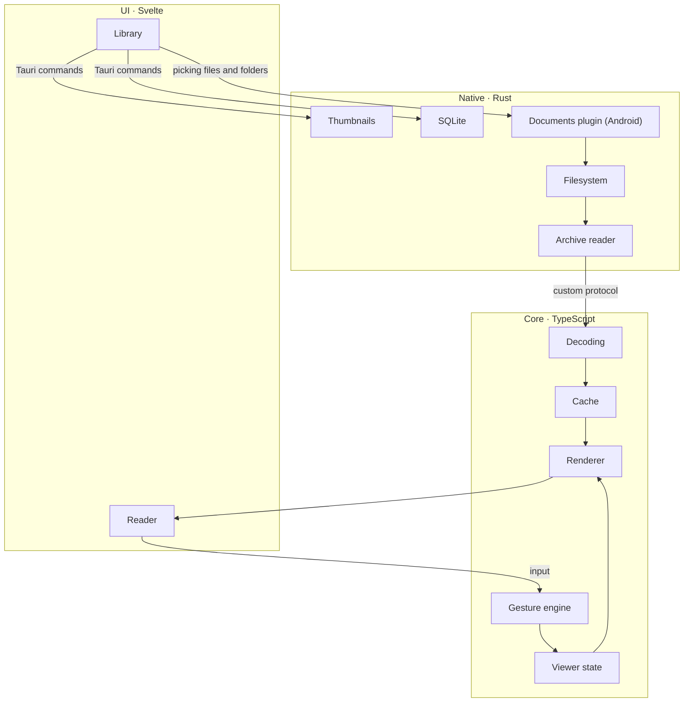

# Gutter — Design document

Started Oct 28, 2026 · Samuele

## Overview and goals

An open-source comic book reader for desktop and mobile that shows pages at full quality and responds to gestures predictably. It exists because the free readers available today degrade images, handle zoom and scroll poorly, and have a dated interface.

Guiding principles:

- **The page comes first.** While reading, the screen holds the comic and a slim options bar that is always there; nothing else gets in its way.
- **Never lose quality.** No image is ever shown at a resolution lower than the screen's.
- **Predictable gestures.** One gesture does one thing; no accidental page turns.
- **Lightweight.** Fast startup, low memory, small installer.
- **One codebase** for Windows, Linux, macOS, Android and iOS.

Non-goals for the first version: online store or comic downloads, cloud sync, file editing, DRM support.

## Requirements

The requirements come from five concrete problems with existing readers, plus the basic features of an MVP.

### Problems to solve

| Problem | Requirement | How we verify it |
| --- | --- | --- |
| Pages lose quality | Always render at the screen's physical resolution; sharp re-render after zoom | On-screen comparison with the original image at 100%, 200%, 400% |
| Poor zoom handling | Pinch centered between the fingers, double tap on an area, pan clamped to the edges | Manual tests on trackpad, mouse, Android touch |
| Scroll too fast, skipped pages | Page changes only on an intentional gesture; trackpad inertia ignored after a page change | No double skip in 50 consecutive swipes |
| Unintuitive UI | Interface hidden while reading, clear tap zones, at most 2 taps to any setting | A new user opens and reads a comic without instructions |
| Dated look | Modern design, dark theme by default, 60 fps animations | Frame time profiling while flipping and zooming |

### MVP features

1. Open CBZ, CBR and image folders (JPEG, PNG, WebP, AVIF).
2. Reading modes: single page, double page, vertical scroll (webtoon).
3. Reading direction left→right and right→left (manga).
4. Preloading of nearby pages within a memory limit.
5. Library with thumbnails and saved reading position for each volume.

After the MVP: PDF, CB7, fixed-layout EPUB, ComicInfo.xml metadata, collections and series.

## Tech stack

Choice: Tauri 2 as the native shell, TypeScript for the interface, gestures and viewer logic, Svelte for the UI. Rust for everything that touches files and archives: reading, extracting single pages, thumbnails, database.

Why this split: a 100 MB CBZ must never be copied whole into JavaScript. Rust opens the archive, reads the index and hands the webview only the bytes of the requested page.

| Layer | Technology | Why |
| --- | --- | --- |
| App shell | Tauri 2 | One codebase for 5 platforms; uses the system webview, installer of a few MB instead of Electron's ~150 MB |
| Language | TypeScript | Already known; typing helps on a codebase that will grow |
| UI | Svelte 5 | Compiles to JS with no heavy runtime; simple reactivity for viewer state |
| Frontend build | Vite | Standard for Svelte, fast hot reload |
| CBZ archives | Rust `zip` crate | Direct access to a single entry through the ZIP index, without reading the whole file |
| CBR archives | Rust `rars` crate (pure Rust, Apache-2.0) | Chosen by the [`cbr-library` spike](spikes/cbr-library.md): builds for Android from Windows with plain `cargo` where the UnRAR bindings fail, a license with no strings, limits for hostile files. Slower than UnRAR on solid RAR5 and cannot open truncated archives |
| Delivering pages to the UI | Tauri custom protocol (e.g. `page://<volume>/<n>`) | The webview loads the page like a URL; no bytes serialized in IPC messages. Verified in the [`page-protocol` spike](spikes/page-protocol.md): at least as fast as IPC |
| Image decoding | The webview's `createImageBitmap` | Native system decoding, off the main thread. Decode only: resizing happens on a canvas in steps, since neither WebKitGTK nor Chromium resizes without moire at every ratio (see the rendering pipeline) |
| PDF (post-MVP) | pdf.js | De facto standard for PDF in the browser |
| Native side | Rust (Tauri commands) | Filesystem, archives, parallel thumbnail generation |
| Persistence | SQLite in Rust (`rusqlite`, bundled) | Library and reading positions, in one file in the app's data folder (see [the library](#the-library)); the SQL plugin was the first idea, the M4 plan moved the queries to Rust where they can be tested |
| Files on Android | A plugin of our own, `src-tauri/plugins/documents` (Kotlin) | The dialog plugin's addresses stop working once the app closes; this one asks with `ACTION_OPEN_DOCUMENT` and `ACTION_OPEN_DOCUMENT_TREE` and keeps the permission, as the [`android-library` spike](spikes/android-library.md) found it must |
| Tests | Vitest + Playwright | Unit tests of the logic, end-to-end tests of the viewer |

Rejected alternatives: Electron + Capacitor (two projects, heavy apps), Python (weak mobile support), C core with native UI (too much work before the first result), archives in JavaScript with fflate or WASM (fflate works on the whole file in memory; RAR in WASM is fragile and slow).

Known stack risks, to verify in milestone M0.5 before building the rest:

- Tauri 2 on mobile is less mature than on desktop; file access on Android goes through the Storage Access Framework (`content://` URIs, not normal paths). **Verified in the [`android-files` spike](spikes/android-files.md):** Rust opens the picked URI as a seekable file through `tauri-plugin-fs` and reads single ZIP entries without loading the archive. *Update in M4:* the address the dialog plugin returns can no longer be read once the app is closed, so a library could not reopen a volume; the [`android-library` spike](spikes/android-library.md) found that addresses picked with `ACTION_OPEN_DOCUMENT`, and files inside a folder picked with `ACTION_OPEN_DOCUMENT_TREE`, keep opening after the app is closed and the phone restarted, once the permission is kept.
- System webviews differ: WebView2 (Windows), WebKitGTK (Linux), WKWebView (macOS/iOS), Android System WebView. Image formats, gesture events and memory limits vary between them.
- On Linux, WebKitGTK is the webview with the most known performance issues.

## Architecture

The app has three layers: UI in Svelte, core in TypeScript, native side in Rust. The core does not depend on the UI, so it can be tested on its own. Filesystem and archive reader live in the Rust layer; decoding, cache, renderer, gestures and viewer state in the TypeScript core.

A page travels this chain (a solid RAR archive is the exception: a page can only be decoded after the ones before it, so those are read in one forward pass with a cache, see the [`cbr-library` spike](spikes/cbr-library.md)): Rust opens the archive and extracts only the requested entry, serves it to the webview through the custom protocol, decoding produces the bitmap, the cache keeps it and the renderer draws it in the reader. In parallel, the gesture engine translates the reader's input into changes to the viewer state, which decides what the renderer must show. The library uses thumbnails and SQLite through Tauri commands.

### The library

Since M4 the volumes the reader added live in `library.sqlite3`, in the app's data folder (`%APPDATA%\io.github.iareb.gutter` on Windows, `~/.local/share/io.github.iareb.gutter` on Linux, the app's private folder on Android), in `src-tauri/src/library.rs`:

- **Two tables.** A volume: its address (a path on a computer, a `content://` address on Android), name, size, fingerprint, page count, when it was added and last opened. Its reading state: the page, whether it is finished, and the direction, page mode and cover chosen while reading it (null: the View menu's choice).
- **A schema version.** The database records its version; the steps from one version to the next are a list in the code, run in one transaction at start, and never changed once released. A database from a newer Gutter is refused rather than touched.
- **The fingerprint** is the file's size and a hash of its first and last 64 KB (64-bit FNV-1a, which never changes between versions, unlike Rust's own hasher): cheap for a file of any size, and the same after a move or a rename.
- **Adding a file** finds it at its address (a file changed in place keeps its place), or by fingerprint at another address. Then the old address decides: if it no longer opens, the file moved or was renamed and the volume takes the new address with its place; if it still opens, the new file is a copy and nothing is added. Without that check a folder holding two copies of one comic would move the volume back and forth each time it is listed (found on the phone in step 4.2).
- **Removing** a volume deletes its rows, never the file.
- **Covers** (`src-tauri/src/thumbs.rs`): the first page in reading order, 400 pixels wide, made by averaging each area of the page, as JPEG at quality 85. Made in Rust the first time the library asks for `thumb://<id>`, at most two at a time, and kept in the cache folder under the volume's fingerprint, so a file changed in place gets a new cover and a moved one keeps its own. A first page Rust cannot decode (AVIF outside Linux) leaves a marker, so it is not tried again, and the library shows a placeholder.
- **Where you left off.** Every file opened joins the library, and opens again at its page with its direction, page mode and cover (`src/core/library.ts`). The place is saved at once on the first change, then at most once a second, keeping the last of a burst of turns, and at once when the app goes to the background, the window is closed or another volume is opened: a closed window waits for that save before it goes. Reaching the last page marks a volume finished, and going back does not undo it.
- **On Android** files and folders are picked through the documents plugin, which keeps the permission to read them; a folder is one permission whatever it holds (Android allows 512 per app), and the system refuses the root of the storage and `Download` itself, so the reader picks a folder inside them.

## Rendering pipeline and image quality

Every page is drawn from the original image, at the screen's physical resolution. Thumbnails exist only in the library.

1. **Compute the target size.** On-screen size in CSS pixels × `devicePixelRatio` × zoom level.
2. **Decode and resize.** The same method on every platform: `createImageBitmap(blob)` decodes at full size, then the page is downscaled on a canvas in steps with `imageSmoothingQuality: 'high'`. Halve while the result is still at least the target; if the target is not reached exactly, scale to twice the target and halve once more. Every path ends in an exact 2:1 step, which averages 2 × 2 pixels.

   Why not `createImageBitmap(blob, { resizeWidth, resizeHeight, resizeQuality: 'high' })`, which decodes and resizes in one call: the [`resize-quality` spike](spikes/resize-quality.md) showed that WebKitGTK ignores `resizeQuality`. M1 step 1.3 then found that Chromium is clean only at large ratios: with 1 px stripes it leaves strong moire between 1 and about 2.8 (25.7 at 1/2.2, the ratio of a 2400 px page on a 1080 px phone), while the spike had only tested 1/3.3. The stepped method is clean from a ratio of 2 up on both Chromium and WebKitGTK. Below 2 some moire remains on 1 px stripes, more on WebKitGTK than on Chromium (at 1/1.7: 31 vs 16); real pages are far less extreme, but this must be checked by eye on real comics. It costs about 25% more time than one-step resize on Android and briefly needs a canvas twice the target size per side. If that proves too slow or too heavy, the alternative is decoding and resizing in Rust (Lanczos). If the original is smaller than the target, show it without more blurry upscaling than necessary.
3. **Keep the original.** The compressed page bytes stay in cache: on zoom, decode again at the new resolution; never upscale an already-reduced bitmap.
4. **Draw.** On a `<canvas>` with a 2D context ([`canvas-vs-img` benchmark](spikes/canvas-vs-img.md)), with exact dimensions, so the browser does not rescale again. Centering alone is not enough: with fractional pixel densities the element lands on fractional positions and the browser resamples it (1.6–3.5% of pixels changed at density 2.8125 and similar). The element is placed on whole physical pixels, its CSS size rounded up to the browser's 1/64 px unit, and drawn with `image-rendering: pixelated`, which is safe at 1:1.
5. **Re-render after zoom.** During the pinch, use a CSS transform (fast but approximate); once the gesture ends, redraw at the new resolution.

For very large pages (scans over ~8000 px per side), high zoom was meant to use tiled rendering: only the visible portion decoded and drawn. An 8000 × 6000 page decoded in full takes about 190 MB, more than the entire mobile budget. *Revised in M3 (step 3.1):* the webview decodes the whole image even to cut a tile from it, so tiles would not lower the peak; such pages are decoded whole for now, and a region decode in Rust is left for after 0.1.

Formats: JPEG (including progressive and CMYK), PNG and WebP decode correctly in all webviews. AVIF does not: it works on WebView2 and Android but not on Ubuntu's WebKitGTK ([`image-formats` spike](spikes/image-formats.md)). Support depends on how each webview is built, so it is detected at runtime, not assumed per platform: if the webview fails to decode a page, the UI asks Rust for the same page as PNG (`page://<volume>/<n>/png`) and keeps those bytes for later re-renders. Rust decodes AVIF with `avif-decode` (pure Rust, BSD, built on rav1d), compiled only on Linux, the only platform that needs it so far; other formats have no fallback decoder and show a clear error. JPEG XL is not supported for now (WebView2 cannot decode it); the same fallback could cover it later.

Rule: no image is ever recompressed to JPEG or cached at reduced quality for reading.

## Gesture engine

All input (touch, mouse, trackpad, keyboard) goes through a single module that translates it into viewer actions. A gesture produces exactly one action: it either moves the view or changes the page, never both.

The module is a state machine with four states: **idle**, **pan**, **pinch**, **page change in progress**. During a page change every other input is ignored until the animation ends.

| Input | Page not zoomed | Page zoomed |
| --- | --- | --- |
| Horizontal swipe (touch) | Changes page only past a distance **and** velocity threshold; otherwise the page snaps back | Pan; changes page only if already at the edge and the gesture starts again from there |
| Pinch | Zoom centered on the midpoint between the fingers | Same |
| Double tap / double click | 2× zoom on the tapped area | Back to "fit to screen" |
| Tap on the sides | Previous / next page | No action |
| Tap in the center | No action: the options bar is always visible | Same |
| Two-finger trackpad scroll | Accumulates movement; changes page past a threshold, then blocks input until inertia dies out | Pan |
| Mouse wheel | One notch = one page | Vertical pan (sideways with Shift or a horizontal wheel); never changes the page, however many notches or pauses |
| Ctrl + wheel / trackpad pinch | Zoom centered on the cursor | Same |
| Arrows, space, PgUp/PgDn | Page navigation | Pan in the four directions, up to the edge; never change the page. Home and End still go to the first and last page |
| Mouse drag with the left button (desktop) | Nothing | Pan |

Telling trackpad inertia apart from intentional scrolling is the most delicate part: browsers do not report it. We estimate it from the trend of `deltaY` values (steadily decreasing values = inertia) and from a lockout window after each page change. This is an empirical estimate: thresholds must be tuned on real devices, they cannot be worked out on paper.

The gesture engine receives normalized events from a small per-platform adapter, because webviews do not produce them the same way. Example: trackpad pinch arrives as a wheel event with `ctrlKey` on Chromium (WebView2, Android). WebKitGTK does not show it to the page at all: it zooms the whole page by itself and `preventDefault` cannot stop it ([`trackpad-pinch` spike](spikes/trackpad-pinch.md)). On Linux the adapter is therefore partly native: Rust catches the GTK touchpad pinch on the webview widget, stops it there and forwards begin / update / end with scale and center. The state machine never sees these differences.

To make the engine testable without a device, any event sequence can be recorded to a file and replayed in automated tests: a reported gesture bug becomes a test that must never fail again.

Thresholds and sensitivity are configurable in the settings.

## UI/UX

The app has two screens: **Library** and **Reader**. While reading, the interface is one slim options bar at the top, always visible, and the page fills the rest.

**Reader**

- An options bar always visible at the top: open a file, title and page number today; settings and the other options go there as they come. It is a bar of its own, not drawn over the page, so it never covers a part of it. A way to hide it for a full-screen page may come as an option.
- A slider for the page in the bar, to go to any page: while it is dragged it shows the page it would go to, and the page is loaded when it stops for a moment or is let go. On a narrow screen it drops to a row of its own.
- The rest of the screen is the page, on a black or dark grey background.
- A bottom bar with a page slider with previews and the page number comes later; whether it is always there or on demand is decided then.
- Tap zones on the sides: left and right 25% of the screen, swapped in manga mode.
- Modes: single page, double page (with single cover and detection of pages that are already spreads), continuous vertical scroll. *Vertical scroll, since M3:* pages fitted to the width with no gap; the wheel moves an eighth of the screen a notch, the keys a screen, ← and → go to the previous and next page; a page whose height is not known yet gets an estimate, and the picture does not move when the real one arrives. *Double page, since M3:* in double page mode a page wider than tall is a spread and shows alone, and so does the page before it, so that the pairs after it stay right; the cover alone is on by default. The pairing needs the shape of every page before the current one: Rust reads it from the image headers, and the viewer waits for it rather than guess.
- Fit: to screen in the page modes; to width in vertical scroll, where it is the point (decided in the M3 plan: a page taller than the screen in a page mode would act as a zoomed one, which the wheel and the keys cannot turn).

**Library**

- Grid of covers with a progress indicator.
- "Continue reading" section at the top.
- Add files or folders by drag and drop (desktop) or system picker (mobile). On Android a folder must be one inside `Download` or the storage, not those themselves: the system refuses them.

**Style guidelines**

- Dark theme by default, optional light theme.
- System typography, rounded corners, no superfluous decorative icons.
- Short animations (150–250 ms) for page transitions, always at 60 fps.
- Settings reachable in at most 2 taps, with an immediate preview of the effect. *Since M3:* a View button in the options bar opens a menu with the reading direction and the page mode; a choice applies at once and closes the menu. The choices hold for every volume and are kept in the webview's storage. *Since M4:* each volume keeps the choices it was read with in the library; the menu shows those of the open volume, a choice made there holds for it and becomes the default for the volumes never read.
- Right to left mirrors what has a side: the tap zones, the left and right arrows, the swipe, the slide of the pages and the slider. What has no side keeps the order of the pages: up and down, PageUp, PageDown, Space and the wheel go forward and back in both directions.

## Memory management and performance

Only the pages around the current one are kept decoded in memory; everything else stays compressed in the archive.

- **Preload window:** current page + 2 next + 1 previous, the other way round after going back (in double page mode, by pairs). Decoded pages are kept for the current page, 2 behind and 3 ahead; farther ones are closed.
- **Memory budget in bytes, not pages:** each bitmap costs width × height × 4 bytes. The budget is configurable, with a lower default on mobile (192 MB on a computer, 96 MB on a phone, counting the compressed bytes too); if a new page exceeds it, the farthest page is freed with `ImageBitmap.close()`, and if the budget cannot fit the whole preload window, the window shrinks (never the quality of the current page).
- **Two cache levels:** compressed bytes (small, we keep many) and decoded bitmaps (large, only around the current page).
- **Read the archive without extracting it all:** Rust reads only the requested page's entry from the ZIP index.
- **Work off the main thread:** extraction in Rust on separate threads, decoding and downscaling in two Workers, so the interface never freezes while flipping or scrolling. (A first measurement in M3 found no gain from a Worker; that was with the accelerated canvas. With the downscale in main memory a page at the full width of a computer screen took 0.5 s on the main thread and stalled scrolling: see the [`page-memory` spike](spikes/page-memory.md).)
- **How a page is made matters more than its size:** drawing the full page on an accelerated canvas leaves it in the graphics memory. Every page is made on a canvas in main memory instead: on a phone a page that is not ready takes about 0.7 s instead of 0.1 s, and the graphics memory stays flat (334 MB at the peak of a fast session against 774 MB).
- **Thumbnails:** generated once, saved to disk (JPEG, decided in the M4 plan: the `image` crate writes only lossless WebP), lazy-loaded while scrolling the library. *Since M4:* see [the library](#the-library); on a phone Android runs this work on its slow cores, so a cover takes 0.2 to 0.4 s there for a usual page, about 4 s for a 7000 × 10000 scan, against tens of milliseconds on a computer.

Measurable targets:

| Metric | Target |
| --- | --- |
| Opening a 100 MB CBZ to the first page | < 500 ms on desktop |
| Page change with a preloaded page | < 16 ms (one frame) |
| Viewer memory while reading a 116 MB volume, above the idle app | < 200 MB on desktop, < 150 MB on mobile (revised in M3: the webview alone takes 148 MB on Windows and 172 MB on the phone; measured +164 MB and +63 to +133 MB) |
| Desktop installer size | < 15 MB |

## Build, distribution and CI

Development happens on Windows and Linux; builds for all platforms are produced by GitHub Actions, free for public repos.

| Platform | Where it's built | Distribution |
| --- | --- | --- |
| Windows | Locally or Windows runner | MSI/NSIS installer on GitHub Releases |
| Linux | Locally (WSL works too) or Ubuntu runner | AppImage and .deb on GitHub Releases |
| Android | Locally with the Android SDK, or Ubuntu runner | APK on GitHub Releases, then F-Droid |
| macOS | macOS runner only | DMG on GitHub Releases |
| iOS | macOS runner only | TestFlight; requires an Apple Developer account ($99/year) |

CI pipeline on every push to `main`: lint, type check, unit tests, desktop build. On every version tag: build all platforms and publish the release.

License: MIT.

## Development with coding agents and validation

The code is written by coding agents (Claude Code). The person leading the project does not know Tauri, Svelte or Rust, so they do not validate code by reading it: they validate behavior. Every technical decision in this document is a hypothesis until a test or a measurement confirms it.

**Working rules**

- An `AGENTS.md` at the repo root summarizes this document: architecture, rules (e.g. "no image recompression"), build and test commands, workflow. It is the format read by most coding agents, so anyone who clones or forks can work with the agent they prefer.
- `CLAUDE.md` starts with the line `@AGENTS.md`, which imports that file into Claude Code. Instructions live in one place and cannot diverge; any Claude Code–specific notes go below that line.
- `AGENTS.md` is updated in the same change that alters architecture, commands or rules.
- Single maintainer, no pull requests: work lands directly on `main` in small steps, one per feature. The agent prepares each change; the maintainer commits and pushes it. Each step comes with what changes for the user and how to try it in under 5 minutes. See [roadmap.md](roadmap.md).
- CI runs on every push: lint, type check, tests, build. A red CI is fixed before anything else, and it is a signal that doesn't require understanding the code.
- When a choice in this document turns out wrong, the agent updates the document in the same change and explains why in plain language.

**How to validate without reading code**

| What | Tool | What the validator looks at |
| --- | --- | --- |
| Image quality | Automated test: pixel-by-pixel comparison between the rendered page and the original | Pass/fail in CI; side-by-side screenshots shown with each change |
| Performance | Benchmark command that prints the metrics from the targets table | Numbers against thresholds: green or red |
| Memory | Benchmark that flips through a 200-page volume and measures the peak | A number in MB |
| Gestures | Tests with recorded event sequences + manual testing | Manual test checklist per milestone |
| Formats | Corpus of test files in the repo (small CBZ/CBR, huge pages, AVIF, odd file names, corrupt archives) | All of them open or show a clear error |

**Manual checklist for each milestone:** a list of 5–15 concrete actions ("open `test-manga.cbz`, set right→left, tap the left side: it must go forward"). The validator performs them on the built app and marks pass/fail. A fail becomes an issue with steps to reproduce.

**Test devices:** at least one Windows PC, one real Android phone (the emulator is not enough for gestures), Linux via WSL or a real machine. macOS and iOS only after 0.1, once a Mac or a tester is available.

## Roadmap and open questions

We start with the viewer, because that's where all the problems of existing readers are concentrated. The library comes once the viewer is solid.

1. **M0 — Skeleton.** Repo, Tauri 2 + Svelte + TypeScript, CI with desktop build, README, `AGENTS.md` (with `CLAUDE.md` importing it), test file corpus.
2. **M0.5 — Risk check.** Throwaway prototypes that answer yes/no questions before building the rest:
   - Does Rust read a page from a 100 MB CBZ and does the webview show it in under 500 ms? **Yes** ([`page-protocol`](spikes/page-protocol.md))
   - Does `createImageBitmap` with high-quality resize work on WebView2, WebKitGTK and Android? **No**: WebKitGTK ignores the quality, and Chromium leaves moire below a ratio of about 2.8; pages are downscaled on a canvas in steps everywhere ([`resize-quality`](spikes/resize-quality.md))
   - Does the app run on a real Android phone and open a file chosen with the system picker? **Yes** ([`android-files`](spikes/android-files.md))
   - Which image formats does each webview decode? Common formats everywhere; **AVIF not on WebKitGTK**, so the Rust fallback is needed ([`image-formats`](spikes/image-formats.md))
   - Does trackpad pinch arrive as a usable event on Windows and Linux? **Not in JavaScript on WebKitGTK**: on Linux a native GTK adapter catches it; Windows not tested yet ([`trackpad-pinch`](spikes/trackpad-pinch.md))

   - Which library reads CBR files? **`rars`**, a pure Rust crate: it returns the same bytes as UnRAR, builds for Android from Windows (the UnRAR bindings do not), and has a free license; its costs are speed on solid RAR5 (about 4 times slower) and no reading of truncated archives ([`cbr-library`](spikes/cbr-library.md))

   Every "no" leads to fixing this document before M1.
3. **M1 — Basic viewer.** Open CBZ, single page, high-quality rendering, keyboard and tap navigation.
4. **M2 — Gesture engine.** Zoom, pan, swipe with thresholds, trackpad inertia handling. Testing on Android.
5. **M2.5 — CBR.** Moved up from M5. A spike first to choose the RAR library, then reading CBR files. It comes before M3 because preloading and the memory budget depend on what a page costs in each format: in a solid RAR archive a page can only be read after decompressing the ones before it.
6. **M2.6 — Navigation by hand.** A zoomed page that neither the wheel nor the arrows can turn, and a page slider. Asked for after trying M2 on the desktop.
7. **M3 — Reading modes.** Double page, vertical scroll, manga direction, preloading and memory budget.
8. **M4 — Library.** Cover grid, thumbnails, reading position saved in SQLite.
9. **M5 — Formats and release.** Image folders, first public 0.1 release on GitHub.
10. **After 0.1.** PDF, CB7, ComicInfo.xml, iOS and macOS builds, F-Droid.

**Rough estimates.** Estimates assume development by coding agents, with one person leading, testing and validating about 10 hours a week. The bottleneck is not writing code but testing it on devices and tuning gestures.

| Milestone | First estimate | Actual or revised (end of M1) | Actual or revised (end of M3) |
| --- | --- | --- | --- |
| M0 + M0.5 | 1–2 weeks | **3 days** (Oct 31 – Nov 2, 2026) | |
| M1 | 1–2 weeks | **6 days** (Nov 2 – Nov 7) | |
| M2 | 3–5 weeks (biggest risk: tuning on real devices) | 2–3 weeks | **6 days** (Nov 7 – 13), the laptop trackpad left |
| M2.5 | — (part of M5) | about 1 week, spike included | **3 days** (Nov 13 – 15) |
| M2.6 | — (asked for during M2) | two or three days | **2 days** (Nov 16 – 17) |
| M3 | 2–3 weeks | 2–3 weeks | **4 days** (Nov 17 – 20) |
| M4 | 1–2 weeks | 1 week | 4–6 days |
| M5 | 1–2 weeks | 1 week (CBR moved to M2.5) | 4–6 days, signed builds included |
| **Total up to 0.1** (Windows, Linux, Android) | **about 3–4 months** | **about 7–10 weeks from now**: release 0.1 around January 2027 | **about 2 weeks from now**: release 0.1 in early December 2026 |

**Revision at the end of M1.** M0 to M1 took about 9 days instead of 2–4 weeks, with more than the assumed 10 hours a week of validation. Writing code was not the bottleneck; finding problems on real devices was. Every step of M1 hit something only a device showed: moire at the phone's real downscale ratio, fractional pixel densities resampling the page, Vite reloading the page on Android, quick taps lost to double-tap detection. So the revision keeps the device-heavy milestones wide:

- **M2** shrinks less than the pace suggests: gestures must be tuned by hand on each device, and Windows trackpad pinch cannot be tested yet (no laptop with a trackpad).
- **M3** stays as it was in the table, but is the biggest piece left (ten steps, see the roadmap): preloading and the memory budget start from measurements that are already over target (about 430 MB of webview memory on Windows after the M1 checklist, against 300 MB), and a page change on the phone takes 300–400 ms. *Update during M3:* after steps 3.1 to 3.3 a preloaded page changes in under 2 ms and the memory is within the restated targets; step 3.9 (tiles) is dropped, so M3 has nine steps instead of ten, three of them done.
- **M4** shrinks: a cover grid and SQLite are well-trodden ground.
- **M5** stays: the CBR library choice (`unrar` or libarchive) and building it for Android are still open. *Update during M2:* CBR moves to its own milestone, M2.5, before M3, with a spike first; M5 keeps image folders and the release. The order changes, not the total.

**Revision at the end of M3.** M2 to M3 took 15 days instead of the 4–6 weeks revised after M1. The pace held because every step was tried on the three platforms the same day, by scripts driving the real app (real events on Windows, WebKitGTK in WSL, a real finger on the phone through adb), so the maintainer's time went to deciding, not to repeating checks. What took longest was not the features but what measuring them turned up: in M3 the memory of the decoded pages (an accelerated canvas keeps every page it ever drew), a scroll that stalled for half a second, two bugs of mine that only showed as numbers, and a graphics cache filled by the slides. M4 and M5 are lighter on that side: a cover grid, SQLite and a release are known ground; the risks left are thumbnails of solid CBR archives (each one a pass over the archive) and signing the Android and Windows builds.

macOS and iOS add 1–3 weeks after 0.1. Next revision at the end of M4.

Open questions:

- [x] Project name: **Gutter**
- [x] License: **MIT**
- [x] Rendering on `<canvas>` or ``: **`<canvas>` with a 2D context** ([`canvas-vs-img` benchmark](spikes/canvas-vs-img.md)): an `` either lets the browser downscale, leaving moire, or needs the page re-encoded as PNG, up to 25 times slower
- [x] CBR library: **`rars`** (pure Rust, Apache-2.0), chosen by the [`cbr-library` spike](spikes/cbr-library.md). The UnRAR license is not an open-source license (F-Droid treats apps bundling it as non-free) and its bindings do not build for Android from Windows; libarchive was not tried, as it needs a C build for every Android target. UnRAR could come back as an optional feature if truncated archives turn out to matter
- [x] Default memory budget on mobile: **96 MB** (192 MB on a computer), set from the M3 measurements ([`page-memory` spike](spikes/page-memory.md))
- [ ] Apple Developer account for iOS: yes or no
